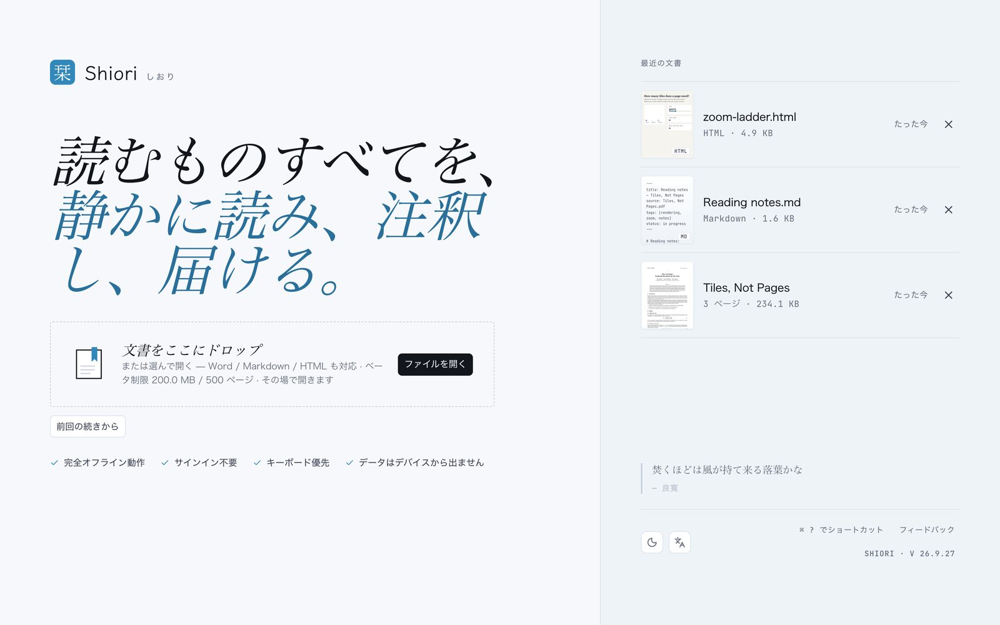

<p align="center">
  
</p>

<h1 align="center">Shiori 栞</h1>

<p align="center">
  PDF、Markdown、HTML のためのローカルファーストな文書リーダー。
</p>

<p align="center">
  <a href="./README.md">English</a>
  ·
  <a href="./README.zh-CN.md">简体中文</a>
  ·
  <a href="./README.ja.md">日本語</a>
</p>

<p align="center">
  <a href="https://shiori.nagi.fun">Web サイト</a>
  ·
  <a href="https://github.com/Nagi-ovo/shiori/releases/latest">ダウンロード</a>
  ·
  <a href="https://github.com/Nagi-ovo/shiori/releases/latest"></a>
</p>



Shiori は、文書をクラウドに預けず、静かに読み、書き込み、書き出すための
文書ワークスペースです。中心となるのは PDF 注釈ですが、Markdown、HTML、Word の
文書も隣のタブで開けます。各タブは自分の状態を保持し、再起動後も復元されます。

## 主な機能

- **PDF の閲覧と注釈**：ハイライト、マークアップ、サムネイル、ページ管理、
  書き出し、ローカル草稿の復元。
- **文書タブ**：PDF、Markdown、HTML、Word（DOCX）を複数開けます。各タブは表示位置や
  状態を保持し、閉じない限り次回起動時にも復元されます。
- **Markdown / HTML プレビュー**：Markdown の front matter を読みやすく表示し、
  HTML は明示的に実行したときだけ隔離サンドボックスで動きます。
- **デスクトップ用サイドツール**：PDF の横に内蔵ブラウザやターミナルを置けます。
  `cc` / Claude Code がローカルに入っていれば、Shiori の内蔵ターミナルから起動できます。
- **ローカルファースト**：文書、注釈、最近使ったファイル、設定はあなたの端末に残ります。
  アカウントもクラウドもテレメトリもありません。
- **デスクトップとモバイル**：macOS、Windows、Linux、Android 直接インストール版。
  iOS / iPadOS と Google Play は各ストア経由で配布します。

## スクリーンショット


## ダウンロード

インストーラーは
[GitHub Releases](https://github.com/Nagi-ovo/shiori/releases) で公開しています。

| プラットフォーム | 推奨パッケージ | 更新方法 |
| --- | --- | --- |
| macOS Apple Silicon | `.dmg` | 署名付きアプリ内アップデート |
| macOS Intel | `.dmg` | 署名付きアプリ内アップデート |
| Windows | `.msi` | 署名付きアプリ内アップデート |
| Linux | `.AppImage`；Debian / Ubuntu は `.deb` | `.AppImage` updater または手動更新 |
| Android 直接インストール版 | `.apk` | アプリ内 APK 更新フロー |
| Google Play | 近日公開 | Google Play |
| iOS / iPadOS | 近日公開 | App Store / TestFlight |

デスクトップ版と Android の直接インストール版は、Shiori 内から更新できます。
Android 直接インストール版は APK をアプリ内でダウンロードして検証したあと、
Android のパッケージインストーラーへ渡します。ストア版は各ストアで更新されるため、
このリポジトリには `.aab` や `.ipa` としてミラーしません。

公開ビルドに有効期限はありません。ビルドの有効期限は、クローズドベータ向けの
オプトインのフラグ（ビルド時に `SHIORI_ENABLE_BUILD_EXPIRY=true`）としてだけ存在し、
リリース版やストア版では有効にしません。

## コマンドラインと Agent skill

`shiori` CLI は、スクリプトや coding agent から PDF を調べ、検索し、描画し、
注釈を付けるためのツールで、Shiori で開いている文書とも連携できます。
[`cli/`](./cli) にあり、独自の `cli-v*` タグでリリースされます。

```sh
curl -fsSL https://shiori.nagi.fun/cli | sh      # macOS、Linux
irm https://shiori.nagi.fun/cli.ps1 | iex        # Windows
npm install -g @nagi-ovo/shiori                  # Node のある環境ならどこでも
```

[`skills/shiori`](./skills/shiori) の agent skill は、Codex、Claude Code、
その他の対応 coding agent に、この CLI の使い方を伝えます。Shiori で開いている
文書の読み取り、本文検索、テキストに結び付いた注釈の追加、callout thread への
返信などです。このフォルダを使っている Agent の skill ディレクトリへリンクするか
コピーしてください（対応する一行だけを実行します）。

```sh
ln -s "$(pwd)/skills/shiori" "${CODEX_HOME:-$HOME/.codex}/skills/shiori"
ln -s "$(pwd)/skills/shiori" "$HOME/.claude/skills/shiori"
```

## ソースからビルドする

[bun](https://bun.sh) と、`wasm32-unknown-unknown` ターゲットを含む Rust
ツールチェーンが必要です。デスクトップ版のビルドには Tauri 2 のシステム依存関係も
必要です。コマンドの一覧は英語版 README の
[Build from source](./README.md#build-from-source) を参照してください。

```bash
bun install
rustup target add wasm32-unknown-unknown
bun run dev            # Web 開発サーバー
bun run tauri:dev      # デスクトップアプリ（ホットリロード）
bun run verify         # build + lint + test + サイトのビルド
```

## コントリビュート

バグ報告、機能要望、pull request を歓迎します。着手する前に
[`CONTRIBUTING.md`](./CONTRIBUTING.md)（英語）をお読みください。

## ライセンス

- コードは [MIT License](./LICENSE) で公開しています。
- 「Shiori」/「栞」という名称、ロゴ、アプリアイコン、その他のブランド素材は MIT
  License の対象外です。[`TRADEMARK.md`](./TRADEMARK.md) を参照してください。
- [`docs/`](./docs) 以下のドキュメントは
  [CC BY 4.0](https://creativecommons.org/licenses/by/4.0/deed.ja) です。
- 同梱のサードパーティ製フォントとコードはそれぞれのライセンスに従います。
  [`THIRD_PARTY_NOTICES.md`](./THIRD_PARTY_NOTICES.md) を参照してください。
