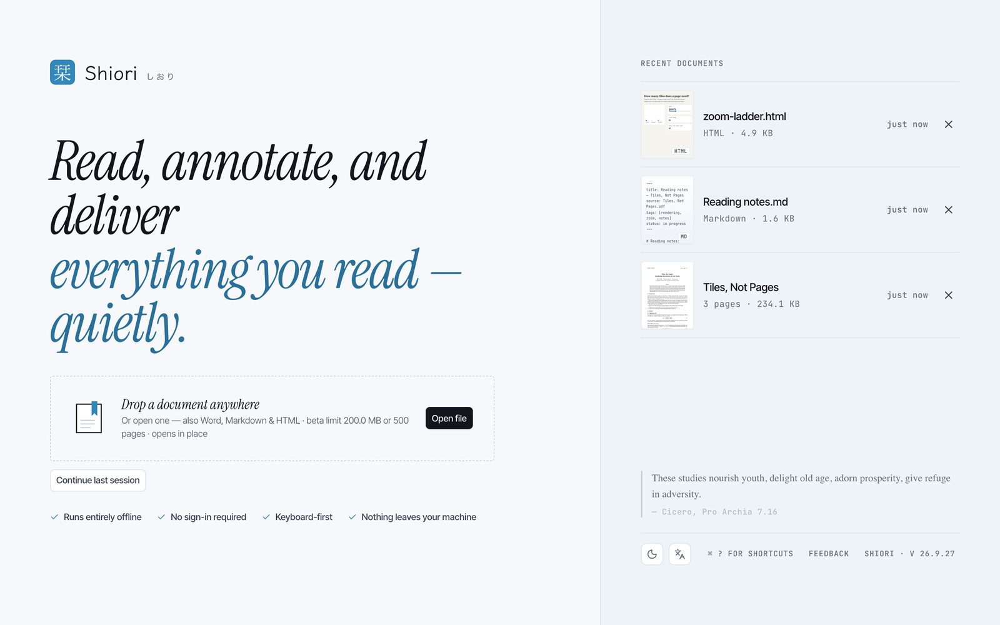

<p align="center">
  
</p>

<h1 align="center">Shiori 栞</h1>

<p align="center">
  A local-first reader for PDF, Markdown, and HTML documents.
</p>

<p align="center">
  <a href="./README.md">English</a>
  ·
  <a href="./README.zh-CN.md">简体中文</a>
  ·
  <a href="./README.ja.md">日本語</a>
</p>

<p align="center">
  <a href="https://shiori.nagi.fun">Website</a>
  ·
  <a href="https://github.com/Nagi-ovo/shiori/releases/latest">Downloads</a>
  ·
  <a href="https://github.com/Nagi-ovo/shiori/releases/latest"></a>
</p>



Shiori is a quiet document workspace for reading, marking up, and shipping
documents without turning them into somebody else's cloud data. PDF annotation is
the core workflow. Markdown, HTML, and Word documents open in tabs next to it,
and each tab keeps its own state across a relaunch.

## Highlights

- **PDF reading and annotation**: highlights, markup tools, thumbnails, page
  management, export, and local draft recovery.
- **Tabs for documents**: open multiple PDF, Markdown, HTML, and Word (DOCX)
  files; each tab keeps its own view state and survives relaunch until you
  close it.
- **Markdown and HTML previews**: Markdown front matter is surfaced cleanly, and
  HTML can run in an isolated sandbox only when you choose to run it.
- **Desktop side tools**: keep an embedded browser or terminal next to a PDF,
  including local shells such as `cc` / Claude Code when they are installed.
- **Local-first storage**: documents, annotations, recent files, and preferences
  stay on your device. No accounts, no cloud, no telemetry.
- **Desktop and mobile targets**: macOS, Windows, Linux, Android direct install,
  with iOS / iPadOS and Google Play distribution handled through their stores.

## Screenshots


## Downloads

Installers are published on the
[GitHub Releases](https://github.com/Nagi-ovo/shiori/releases) page.

| Platform | Recommended package | Update path |
| --- | --- | --- |
| macOS Apple Silicon | `.dmg` | Signed in-app updater |
| macOS Intel | `.dmg` | Signed in-app updater |
| Windows | `.msi` | Signed in-app updater |
| Linux | `.AppImage`; `.deb` for Debian / Ubuntu | `.AppImage` updater or manual package update |
| Android direct install | `.apk` | In-app APK update flow |
| Google Play | Coming soon | Google Play |
| iOS / iPadOS | Coming soon | App Store / TestFlight |

Desktop and Android direct-install builds can update from inside Shiori. Android
direct-install builds download and verify the APK before handing it to the
Android package installer. Store builds are updated by their stores and are not
mirrored here as `.aab` or `.ipa` files.

Public builds never expire. Build expiry exists only as an opt-in flag for
closed betas (`SHIORI_ENABLE_BUILD_EXPIRY=true` at build time); no release or
store build sets it.

## Command line and agent skill

The `shiori` CLI inspects, searches, renders, and annotates PDFs from scripts
and coding agents, and can talk to the document open in the app. It lives in
[`cli/`](./cli) and releases on its own `cli-v*` tags.

```sh
curl -fsSL https://shiori.nagi.fun/cli | sh      # macOS, Linux
irm https://shiori.nagi.fun/cli.ps1 | iex        # Windows
npm install -g @nagi-ovo/shiori                  # anywhere with Node
```

The agent skill in [`skills/shiori`](./skills/shiori) teaches Codex,
Claude Code, and other compatible coding agents how to drive the CLI: inspect
the document open in Shiori, find passages by text, add anchored annotations,
and reply inside callout threads. Link or copy the folder into your agent's
skill directory, using the line for the agent you use:

```sh
ln -s "$(pwd)/skills/shiori" "${CODEX_HOME:-$HOME/.codex}/skills/shiori"
ln -s "$(pwd)/skills/shiori" "$HOME/.claude/skills/shiori"
```

## Build from source

One React + TypeScript codebase ships as the web app, the Tauri 2 desktop
bundle (macOS, Windows, Linux), and the Android app. PDFs are read and drawn
by PDFium through `crates/shiori-core` (Rust): natively on desktop, as
WebAssembly in a worker on web and Android. `pdf-lib` writes exports.

Prerequisites:

- [bun](https://bun.sh) (the only supported package manager)
- Rust stable with the `wasm32-unknown-unknown` target, plus the
  [Tauri 2 system dependencies](https://tauri.app/start/prerequisites/)
  for desktop builds

```bash
bun install
rustup target add wasm32-unknown-unknown

bun run dev            # web dev server at localhost:1573
bun run tauri:dev      # desktop app with hot reload
bun run build          # TS + Vite production build to dist/ (compiles shiori-core to wasm)
bun run tauri build    # local release desktop bundle (.app + .dmg on macOS)

bun run lint           # ESLint
bun run test           # full bun test suite
bun run test:core      # Rust crates: fmt, clippy, tests, node + wasm bindings
bun run verify         # build + lint + test + site build/lint
```

The pinned wasm-bindgen CLI installs itself into `vendor/tools/` on the first
build. Android builds, code signing, and the release flow are described in
[`docs/BUILD-AND-RELEASE.md`](./docs/BUILD-AND-RELEASE.md). The website is its
own Vite project under [`site/`](./site). Conventions for coding agents and
humans alike are in [`AGENTS.md`](./AGENTS.md); the current working state is in
[`HANDOFF.md`](./HANDOFF.md).

## Contributing

Bug reports, feature requests, and pull requests are welcome. Please read
[`CONTRIBUTING.md`](./CONTRIBUTING.md) first.

## License

- The code is released under the [MIT License](./LICENSE).
- The name "Shiori" / "栞", the logo, the app icons, and other brand artwork
  are not covered by the MIT License; see [`TRADEMARK.md`](./TRADEMARK.md).
- The documentation under [`docs/`](./docs) is licensed under
  [CC BY 4.0](https://creativecommons.org/licenses/by/4.0/).
- Bundled third-party fonts and code keep their own licenses; see
  [`THIRD_PARTY_NOTICES.md`](./THIRD_PARTY_NOTICES.md).
