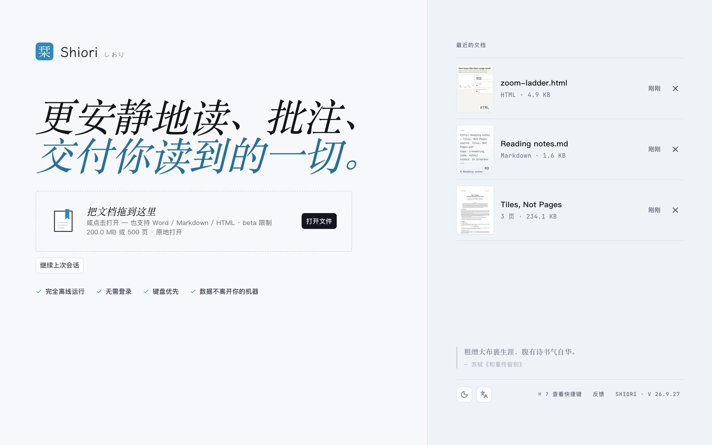
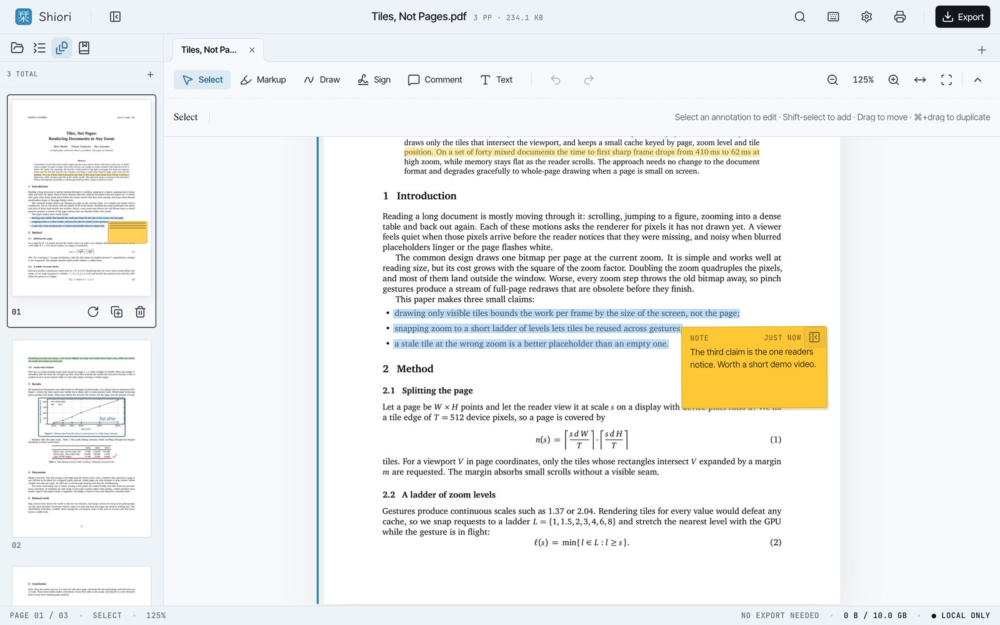
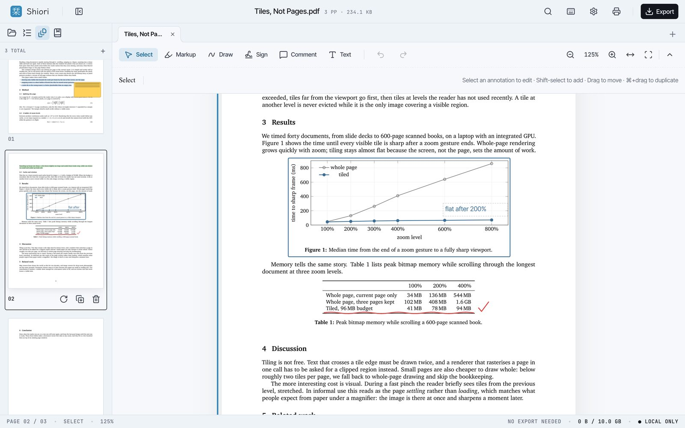
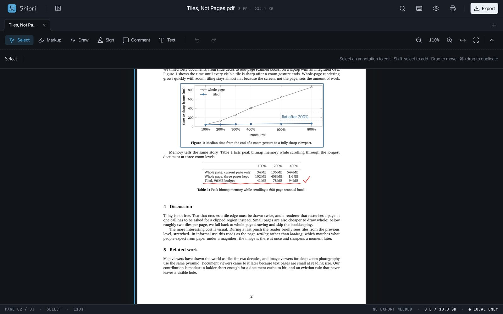
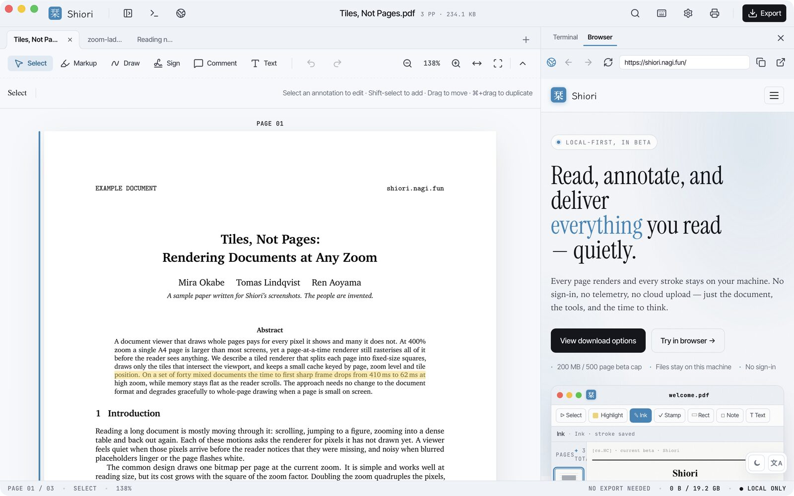
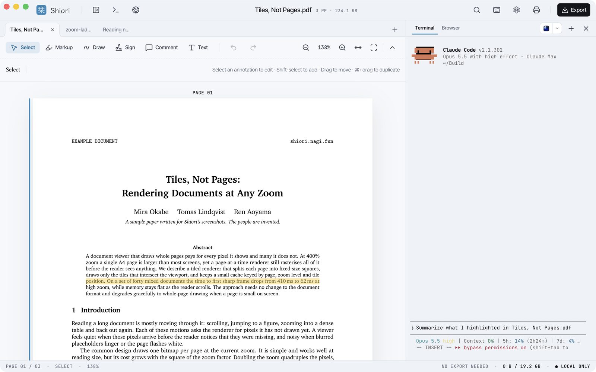
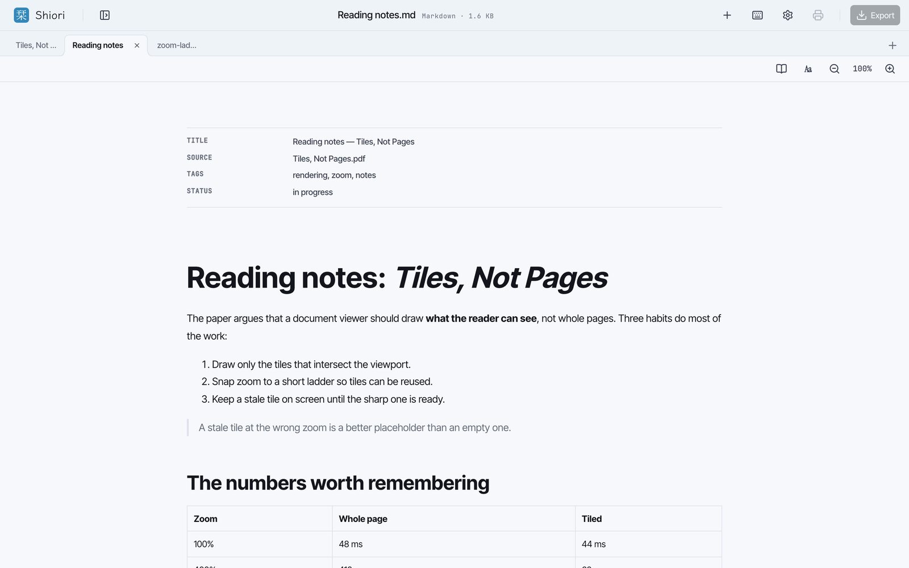
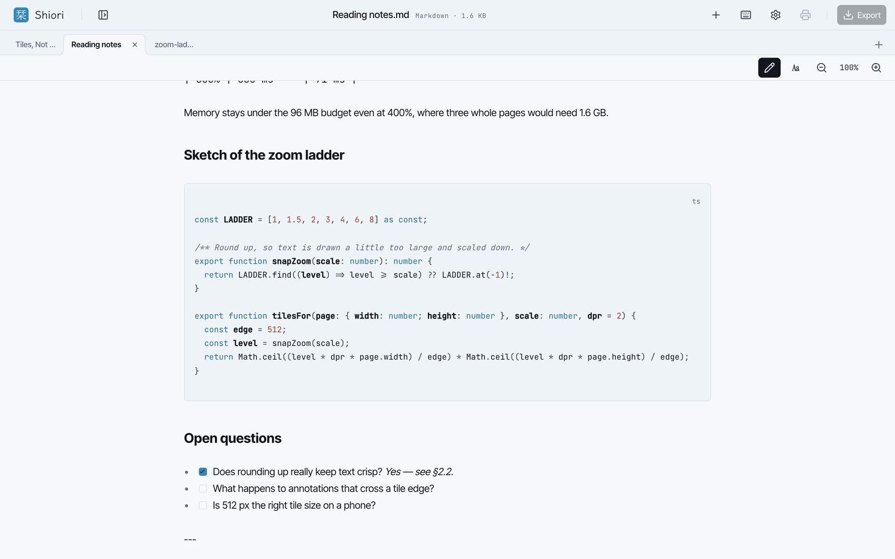
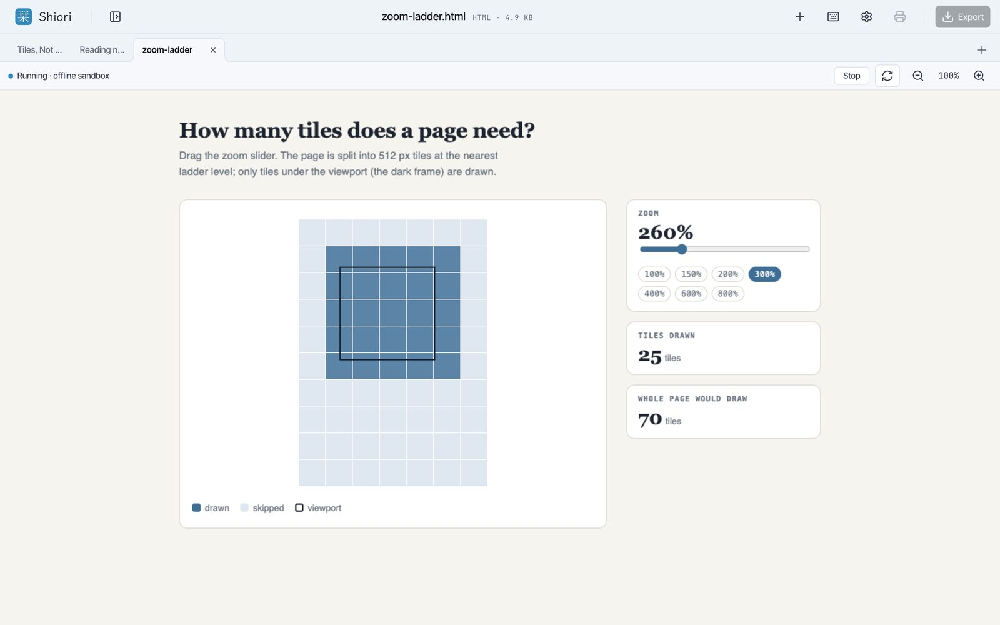

<p align="center">
  
</p>

<h1 align="center">Shiori 栞</h1>

<p align="center">
  本地优先的 PDF、Markdown 与 HTML 文档阅读工具。
</p>

<p align="center">
  <a href="./README.md">English</a>
  ·
  <a href="./README.zh-CN.md">简体中文</a>
  ·
  <a href="./README.ja.md">日本語</a>
</p>

<p align="center">
  <a href="https://shiori.nagi.fun">官网</a>
  ·
  <a href="https://github.com/Nagi-ovo/shiori/releases/latest">下载</a>
  ·
  <a href="https://github.com/Nagi-ovo/shiori/releases/latest"></a>
</p>



Shiori 是一个安静的文档工作区：阅读、批注、整理、导出，都尽量留在本机。
PDF 批注是核心工作流；Markdown、HTML 与 Word 文档可以在旁边的标签页里打开，
每个标签页保留自己的状态，重启后照样恢复。

## 功能亮点

- **PDF 阅读与批注**：高亮、标记工具、缩略图、页面管理、导出、本地草稿恢复。
- **多文档 Tab**：可以同时打开 PDF、Markdown、HTML 与 Word（DOCX）；每个 Tab 保留
  自己的视图状态，下次启动会恢复，除非你手动关闭它。
- **Markdown 与 HTML 预览**：Markdown front matter 会清晰展示；HTML 只有在你选择运行时，
  才会进入隔离沙盒执行。
- **桌面侧边工具**：PDF 旁边可以直接打开内置浏览器或终端；如果本机装了 `cc` /
  Claude Code，也可以在 Shiori 的内置终端里启动。
- **本地优先**：文档、批注、最近文件与偏好设置都保留在你的设备上。没有账号、
  没有云端、没有遥测。
- **桌面与移动端目标**：macOS、Windows、Linux、Android 直装版；iOS / iPadOS 与
  Google Play 通过对应商店分发。

## 截图

















## 下载

安装包发布在
[GitHub Releases](https://github.com/Nagi-ovo/shiori/releases) 页面。

| 平台 | 推荐安装包 | 更新方式 |
| --- | --- | --- |
| macOS Apple Silicon | `.dmg` | 已签名的应用内更新 |
| macOS Intel | `.dmg` | 已签名的应用内更新 |
| Windows | `.msi` | 已签名的应用内更新 |
| Linux | `.AppImage`；Debian / Ubuntu 可用 `.deb` | `.AppImage` 更新或手动更新 |
| Android 直装版 | `.apk` | 应用内 APK 更新流程 |
| Google Play | 敬请期待 | Google Play |
| iOS / iPadOS | 敬请期待 | App Store / TestFlight |

桌面端和 Android 直装版都可以在 Shiori 内更新。Android 直装版会在应用内下载并
校验 APK，然后交给 Android 系统安装器。商店版由对应商店更新，不会在这里镜像
`.aab` 或 `.ipa`。

公开发布的版本不会过期。构建过期只是给封闭内测准备的可选开关（构建时设置
`SHIORI_ENABLE_BUILD_EXPIRY=true`），正式发布版和商店版都不会打开它。

## 命令行与 Agent skill

`shiori` CLI 可以在脚本和 coding agent 里检查、搜索、渲染、批注 PDF，也能和
Shiori 当前打开的文档联动。它位于 [`cli/`](./cli)，按自己的 `cli-v*` tag 发布。

```sh
curl -fsSL https://shiori.nagi.fun/cli | sh      # macOS、Linux
irm https://shiori.nagi.fun/cli.ps1 | iex        # Windows
npm install -g @nagi-ovo/shiori                  # 任何装有 Node 的环境
```

[`skills/shiori`](./skills/shiori) 里的 agent skill 会告诉 Codex、Claude Code
等兼容的 coding agent 如何使用这个 CLI：读取 Shiori 当前打开的文档、按文本定位
原文、添加锚定批注，以及在引线批注中继续回复。把这个目录链接或复制到对应
Agent 的 skill 目录即可，只需执行你在用的那个 Agent 对应的一行：

```sh
ln -s "$(pwd)/skills/shiori" "${CODEX_HOME:-$HOME/.codex}/skills/shiori"
ln -s "$(pwd)/skills/shiori" "$HOME/.claude/skills/shiori"
```

## 从源码构建

需要 [bun](https://bun.sh) 和带 `wasm32-unknown-unknown` target 的 Rust 工具链；
桌面构建还需要 Tauri 2 的系统依赖。完整命令见英文 README 的
[Build from source](./README.md#build-from-source)。

```bash
bun install
rustup target add wasm32-unknown-unknown
bun run dev            # Web 开发服务器
bun run tauri:dev      # 桌面应用（热重载）
bun run verify         # build + lint + test + 官网构建
```

## 参与贡献

欢迎提 bug、功能建议和 pull request。动手前请先阅读
[`CONTRIBUTING.md`](./CONTRIBUTING.md)（英文）。

## 许可证

- 代码采用 [MIT License](./LICENSE)。
- "Shiori" / "栞" 名称、logo、应用图标和其他品牌素材不在 MIT 许可范围内，详见
  [`TRADEMARK.md`](./TRADEMARK.md)。
- [`docs/`](./docs) 下的文档采用
  [CC BY 4.0](https://creativecommons.org/licenses/by/4.0/deed.zh-hans)。
- 内置的第三方字体和代码保留各自的许可证，见
  [`THIRD_PARTY_NOTICES.md`](./THIRD_PARTY_NOTICES.md)。
